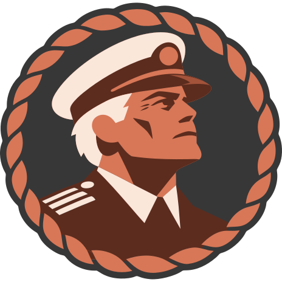
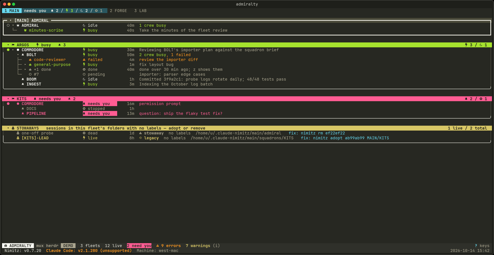

<p align="center">
  
</p>

# claude-nimitz

Run a whole team of Claude Code sessions the way a navy runs its ships: with
names, a chain of command, and one screen that shows you everything.

Version 0.7.20 ([CHANGELOG](CHANGELOG.md): read "Upgrading" first). Status: in testing (Claude Code 2.1.288 - 2.1.316).

Claude Code can leave work running in the background. One or two sessions are
easy to follow. A dozen are not: which one is stuck on a question, which one
died, and which conversation goes with which folder after a reboot?
claude-nimitz gives every session a place in a fleet, shows you what needs
you, and brings the whole fleet back with one command. Only the `claude` CLI
runs underneath, so a subscription login or Bedrock both work.



## The three parts

**`nimitz`, the command.** Creates fleets, starts and stops sessions, and
checks that everything is healthy. It's what you type, and what the sessions
themselves run to manage the fleet.

**Admiralty, the screen.** A terminal dashboard of every fleet on the machine:
who is busy, who waits on you, what went wrong and how to fix it. You can act
from it too, and it shows the exact `nimitz` command before anything runs.

**The nimitz plugin, inside every session.** A Claude Code plugin that ties
each session to its place in the fleet, hands it the rules for its role when
it starts, and teaches the leads how to run things. This is why you can talk to
a fleet in plain words.

[Herdr](https://herdr.dev), a terminal multiplexer, is optional. It adds a
visible pane for each session you want to watch. Without it, status,
configuration and ships all still work.

## The chain of command

| Rank | How many | What it does |
| --- | --- | --- |
| **Admiral** | One per fleet | Leads the fleet; your first point of contact |
| **Commodore** | One per squadron | Leads a squadron, hands out work, watches over its ships |
| **Ship** | As many as you need | Does the long work, each in its own folder |

You talk to the top; the work flows down. A member's name is its path:
`HOME` is an admiral, `HOME/WEB` a commodore, `HOME/WEB/API` a ship.

## Setup

You need Rust (cargo) and Claude Code.

```sh
git clone -b dev https://github.com/avatarye/claude-nimitz && cd claude-nimitz
cargo install --path crates/nimitz       # the command
cargo install --path crates/admiralty    # the screen
claude plugin marketplace add "$PWD" && claude plugin install nimitz@claude-nimitz
nimitz init --label laptop               # name this machine
nimitz doctor                            # repeat until: [OK] doctor: ready
```

To open Admiralty over whatever you're doing in Herdr, run
`herdr plugin link <repo>/herdr-plugin` and bind a key to `admiralty.toggle`
([how](herdr-plugin/README.md#install)).

To upgrade, install both binaries again, run
`claude plugin marketplace update claude-nimitz && claude plugin update nimitz@claude-nimitz`,
then `nimitz doctor`. The CHANGELOG's "Upgrading" section says what else a
release needs.

## Your first fleet

```sh
nimitz fleet new HOME --yes                               # a fleet and its admiral
nimitz squadron new HOME/WEB --brief "the web app" --yes  # a squadron and its commodore
nimitz ship new HOME/WEB/API --dir ~/code/project \
  --prompt "keep the test suite green" --yes              # a ship, in one folder
nimitz start HOME/... HOME/WEB/API --yes                  # launch all three
nimitz status                                             # what runs, what waits on you
```

Then run `admiralty`. To try all of this without touching your setup, use a
fake world first:

```sh
nimitz sandbox create /tmp/nz --herdr && eval "$(nimitz sandbox env /tmp/nz)"
```

## Using it day to day

**Talk to your leads.** Once a fleet runs, its admiral and commodores do most
of the fleet work themselves. Open one and ask in plain words: "start a ship
for the docs", "what's blocked?". They wait for your OK before anything
risky, such as removing a fleet or dropping a conversation.

**Watch in Admiralty.** `j`/`k` move, `tab` changes fleet, `space` finds any
member, `!` shows what waits on you, `i` lists every issue with its fix,
`enter` jumps to a member's pane, and `?` shows every key.

**Step into a member.** `nimitz open HOME/WEB/API` gives you its pane. Press
`ctrl-z` to leave; the session keeps running. Don't type `/exit` there: it
opens Claude Code's agent view instead of ending the member.

**Send a message.** `nimitz signal HOME/WEB/API "run the tests"`.

**After a reboot, a Claude Code update or a Herdr restart,** run
`nimitz muster`. It works out which of the three happened, member by member,
and brings everything back. Running it twice is harmless.

**When something looks wrong,** run `nimitz check` for a fleet or
`nimitz doctor` for this machine's install. Every problem comes with the one
line that fixes it.

Two habits keep a fleet healthy:

- Don't start, resume or stop a member with `claude` yourself. It creates
  copies nimitz can't manage. Use `nimitz start`, `restart` and `stop`.
- Read the plan first. Commands that change a fleet show their plan and ask.
  `--plan` only looks; `--yes` skips the question.

The commands you'll reach for most:

| Command | What it does |
| --- | --- |
| `nimitz status [<path>]` | The members, their state and their issues |
| `nimitz start <path>` | Bring members up |
| `nimitz stop <path>` | Stop members, ships first |
| `nimitz restart <path>` | Relaunch, keeping the conversation |
| `nimitz muster` | Bring everything back |
| `nimitz open <path>` | Show a member in a pane |
| `nimitz signal <path> <text>` | Send a member a message |
| `nimitz squadron new\|set` | Create or change a squadron |
| `nimitz ship new\|set` | Create or change a ship: folder, prompt, mode, effort |

`HOME/...` means everything under a fleet, and `//...` means every fleet.
`nimitz help` lists all commands, and `nimitz help <command>` explains one.

## How it works

**Every member is a background job.** A session keeps running with no terminal
attached. A pane is only a window onto it, so closing a pane or detaching
never stops the work.

**A name is an identity.** Each session carries its place in the fleet, so
nimitz can always tell a real member from a stray session or an accidental
copy, and can resume the exact conversation later.

**Roles come with the session.** When a member starts, nimitz hands it the
rules for its rank, plus anything you've set for the whole fleet. Nobody has to
remember to brief it.

**Status comes from the sessions.** The plugin's hooks record what each session
does, and nimitz reads that alongside Claude Code's own records. That's how a
ship stuck on a question reaches its commodore, even when nobody is watching
that session.

**Plans come first.** A change to a fleet is worked out and shown to you before
anything runs, and a plan that isn't safe is refused whole. Admiralty and the
command share the same plans, so the two agree.

**A fleet can share what it learns.** Each fleet can have a knowledge base, a
git repository that every machine clones, plus common rules, agents and skills
that every member receives. A fleet can also span several machines.

## Learn more

- [docs/usage.md](docs/usage.md): the detail behind this page, and fixes for
  common problems
- [DEVELOPMENT.md](DEVELOPMENT.md): architecture, APIs and inner workings, for
  anyone changing the code, human or agent
- [crates/admiralty/README.md](crates/admiralty/README.md): Admiralty in full
- [docs/design/](docs/design/): design notes

Note: "Claude" is an Anthropic trademark. This name is for private use; check
Anthropic's trademark guidelines before any public release.
